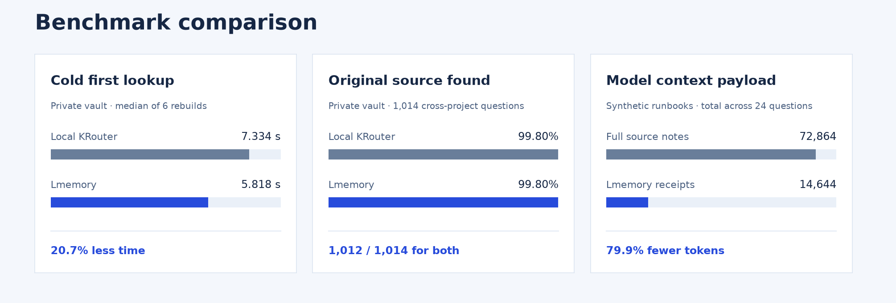

# Lmemory

<!-- mcp-name: io.github.tinkcarlos/lmemory -->

[简体中文](README.zh.md) · [MIT License](LICENSE)

**Local, source-backed memory for Codex and other MCP clients.** Point Lmemory at a Markdown folder to recover previous decisions, corrections, and conversation records. Each lookup returns evidence the agent can cite.



Use Lmemory to carry a project's decisions across chats, find the rule that replaced an older one, or locate the original answer to a question you asked on a specific date.

## How it works

1. **Index the notes locally.** SQLite FTS5 indexes titles, terms, and paragraph evidence from Markdown files. An alias can point directly to a known source. Other queries rank candidates by their terms, scope, date, and evidence.
2. **Return evidence the agent can check.** A receipt contains matching source paths, short excerpts, and line numbers. It also tells the agent whether the vault provides direct support, related material, or too little evidence. The agent can open a cited note when the excerpt leaves information out.
3. **Keep the first lookup and context smaller.** During a rebuild, Lmemory shares text normalization between tokenization and evidence tagging, reuses results for repeated paragraphs, and reduces regular-expression work. During lookup, it puts the receipt into the agent's context so the agent can consult full notes selectively.

## Quick start

Use Python 3.9 or newer with SQLite FTS5.

```sh
git clone https://github.com/TinkCarlos/Lmemory.git
cd Lmemory
python3 -m venv .venv
. .venv/bin/activate
python -m pip install .
lmemory demo --lang en
```

The demo builds a temporary sample vault. It exercises a lookup, a changed decision, and a question the vault cannot answer.

For Windows and client-specific setup, see the [installation guide](docs/INSTALL.md).

### Ask about your own notes

```sh
LMEMORY_NO_QUERY_LOG=1 lmemory --vault "/absolute/path/to/notes" ask "What did we decide about releases?"
```

### Connect Codex over MCP

Add this to your Codex configuration and replace the paths. The tool is called `lmemory_ask`.

```toml
[mcp_servers.lmemory]
command = "/absolute/path/to/Lmemory/.venv/bin/lmemory"
args = ["--vault", "/absolute/path/to/notes", "mcp"]

[mcp_servers.lmemory.env]
LMEMORY_NO_QUERY_LOG = "1"
```

A lookup runs locally and returns source paths, evidence lines, and one of three memory states, `direct`, `related`, or `none`. The retrieval path uses SQLite and runs without an API key.

## What changed from KRouter

Lmemory normalizes each paragraph once for tokenization and evidence tagging. It reuses results for repeated paragraphs within the same rebuild and reduces regular-expression work for dates, durations, frequencies, and other numeric evidence. Dated recall recognizes session excerpts imported by both KRouter and Lmemory.

### Local Codex vault comparison

Both versions used the same frozen vault of **1,801 Markdown pages** with Python 3.12.13 on the same Mac. The baseline was the previously installed local KRouter build, which already included earlier optimizations. Each cold round started with a separate empty cache, timed the first stdio MCP lookup through the completed index rebuild, and alternated the order of the two builds between rounds.

| Metric | Local KRouter | Lmemory |
| --- | ---: | ---: |
| Median first lookup with a rebuilt index, 6 rounds | 7.334 s | **5.818 s** |
| Cross-project questions that found the original session and date | 1,012 / 1,014 | 1,012 / 1,014 |
| Cross-project questions with all expected facts covered | 1,012 / 1,014 | 1,012 / 1,014 |
| Verifiable facts in cross-project sources | 1,958 / 1,962 | 1,958 / 1,962 |

Lmemory was faster in **all six cold rounds** and reduced the median by **20.7%**. In a separate three-round replay of the same **1,030 questions**, all **3,090 pairs of retrieval receipts** matched after removing observation timestamps. The comparison covers retrieval and source evidence in the local installation. This repository publishes the aggregate results and the indexed retrieval improvements. The public lookup uses saved vault notes and imported excerpts as evidence.

### Warm recall and context tokens

On **24 public synthetic questions** about 12 fictional runbooks, the expected source ranked first on **24/24** questions. In three warmed runs of 120 stdio MCP lookups each on the test Mac, the median ranged from **2.56 to 2.96 ms**, and the 95th percentile ranged from **3.24 to 4.06 ms**.

| Payload for the same 24 questions | Total input tokens |
| --- | ---: |
| Full text of the same retrieved source notes, with paths | 72,864 |
| Lmemory MCP receipts, including evidence and retrieval metadata | **14,644** |

That is **79.9% fewer context tokens** in this workload. This counts the compared payloads using `o200k_base`, with temporary vault paths normalized. Model instructions, tool schemas, generated answers, and subsequent reads are outside this measurement.

```sh
uv run --no-project --with tiktoken==0.14.0 python bench/scale/context_budget.py
```

### Cold lookup comparison

This earlier comparison uses the Lmemory build pinned by `lmemory-bench-20261119`.

Each checkout used the same 10,017 Markdown pages (10,000 generated pages plus the public template) on an Apple M5 with Python 3.12.13. We timed the first stdio MCP query with an empty cache, ran six rounds, and reversed checkout order every other round.

| Checkout | Median first lookup | Indexed paragraph evidence |
| --- | ---: | --- |
| [KRouter v2.1.2](https://github.com/398894496-arch/KRouter/releases/tag/v2.1.2) | 6.681 s | Baseline |
| [Upstream KRouter `673007d`](https://github.com/398894496-arch/KRouter/commit/673007d) | 7.482 s | Identical |
| **Lmemory** | **6.159 s** | Identical |

On this workload, Lmemory reduced median cold lookup by **17.7%** versus its upstream base and **7.8%** versus the stable release. The first query and 36 public retrieval questions produced **222/222 identical receipts** per comparison across the six rounds after normalizing timestamps and checkout paths. Lmemory was faster in five of six rounds against v2.1.2 and in all six against the pinned upstream base. These are retrieval measurements on a synthetic vault. Model-generated answers and other vaults can behave differently.

### Reproduce the comparison

Run these commands from the Lmemory checkout. The `lmemory-bench-20261119` tag pins the build measured here.

```sh
git clone https://github.com/398894496-arch/KRouter.git ../krouter-upstream
git -C ../krouter-upstream worktree add --detach ../krouter-v2.1.2 v2.1.2
git -C ../krouter-upstream worktree add --detach ../krouter-673007d 673007d
git worktree add --detach ../lmemory-bench lmemory-bench-20261119
python3 ../lmemory-bench/bench/scale/cold_rebuild.py ../krouter-v2.1.2 ../krouter-673007d ../lmemory-bench --rounds 6
```

The benchmark generates its own notes and uses isolated caches. It reports cold lookup time, receipt equality, and paragraph evidence equality.

## Documentation

<a name="works-with"></a>

- Lmemory supports local stdio MCP clients. See [installation and client setup](docs/INSTALL.md) for Codex, Claude Code, Cursor and other integrations.

<a name="what-it-does-not-do"></a>

- See the [implementation guide](docs/DETAILS.md) for retrieval and configuration.

<a name="measured-not-claimed"></a>
<a name="check-it-yourself"></a>

- See the [local Codex vault comparison](#local-codex-vault-comparison) and the [reproducible synthetic benchmark](#cold-lookup-comparison).

## Credits and license

Lmemory is maintained by [Tink](https://github.com/TinkCarlos) and adapted from [KRouter](https://github.com/398894496-arch/KRouter). The original copyright notice and [MIT license](LICENSE) are preserved.
