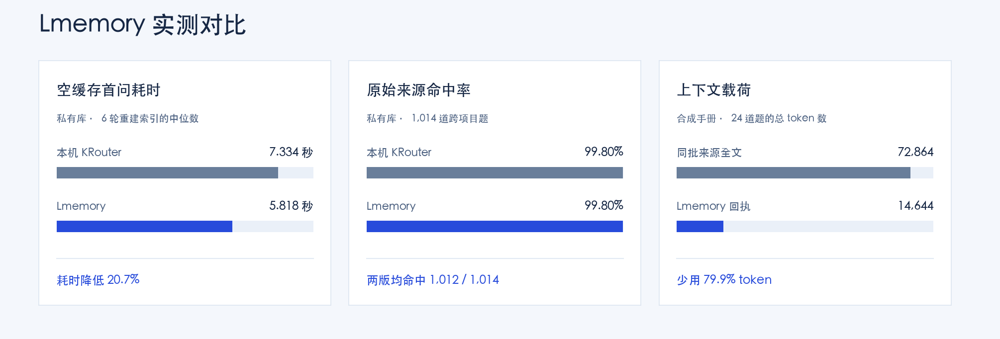

# Lmemory

[English](README.md) · [MIT 许可证](LICENSE)

**给 Codex 和其他 MCP 客户端用的本地记忆工具。** 把 Lmemory 指向一个 Markdown 文件夹，就能查找过去的决定、纠正和会话记录。每次检索都会返回可以核对的出处。



换个聊天窗口继续做同一个项目时，可以用它找回之前确认的决定、查哪条新规则取代了旧规则，或定位某一天你问过的问题和当时的回答。

## 工作原理

1. **在本机为笔记建索引。** 用 SQLite FTS5 索引 Markdown 的标题、词项和段落证据。常用别名可以直接指向已知来源，其余问题结合关键词、查询范围、日期和证据排序。
2. **给助手返回可核对的证据。** 检索回执包含来源路径、短摘录和行号，并说明库里有直接依据、只有相关资料，还是缺少足够证据。摘录信息不够时，助手可以打开对应原文。
3. **减少首问等待和上下文占用。** 重建索引时，分词和证据打标签共用一次文本规范化，重复段落复用结果，并减少正则扫描。查询时，助手先收到回执，再按需打开完整笔记。

## 快速开始

需要 Python 3.9 或更新版本，以及 SQLite FTS5。

```sh
git clone https://github.com/TinkCarlos/Lmemory.git
cd Lmemory
python3 -m venv .venv
. .venv/bin/activate
python -m pip install .
lmemory demo --lang zh
```

演示会在临时目录建立样例库，展示查找原决定、查到更新后的决定，以及库里缺少答案时的回执。

也可以直接运行固定发布版的演示。

```sh
uvx --from git+https://github.com/TinkCarlos/Lmemory@v2.1.3 lmemory demo --lang zh
```

接入客户端可下载 [macOS 与 Linux 安装脚本](https://github.com/TinkCarlos/Lmemory/releases/latest/download/bootstrap.sh)、[Windows 安装脚本](https://github.com/TinkCarlos/Lmemory/releases/latest/download/bootstrap.ps1)或 [Claude Desktop 扩展](https://github.com/TinkCarlos/Lmemory/releases/latest/download/Lmemory.mcpb)。客户端选项见[安装指南](docs/INSTALL.zh.md)。

### 查询自己的笔记

```sh
LMEMORY_NO_QUERY_LOG=1 lmemory --vault "/你的/笔记目录" ask "我们之前怎么定的发布流程？"
```

### 通过 MCP 接入 Codex

把下面这段加入 Codex 配置并替换路径，查询工具名是 `lmemory_ask`。

```toml
[mcp_servers.lmemory]
command = "/absolute/path/to/Lmemory/.venv/bin/lmemory"
args = ["--vault", "/笔记目录的绝对路径", "mcp"]

[mcp_servers.lmemory.env]
LMEMORY_NO_QUERY_LOG = "1"
```

检索在本机运行，返回来源路径、证据行，以及三种记忆状态之一。`direct` 有直接依据、`related` 只有相关记录、`none` 没有足够依据。检索使用 SQLite，无需 API 密钥。

## 相比 KRouter 改了什么

Lmemory 在重建索引时对每个段落只做一次文本规范化，供分词和证据打标签共用。同一次重建中，重复出现的段落会复用处理结果。日期、时长、频率等数字证据也减少了正则扫描。按日期检索历史对话时，可以识别 KRouter 和 Lmemory 导入的会话摘录。

### 本地 Codex 知识库对比

两个版本在同一台 Mac 上使用 Python 3.12.13，读取同一份 **1,801 页 Markdown** 的知识库快照。基线是此前日常使用、已包含早期优化的 KRouter 本机版。每轮使用独立空缓存，计时从发出第一条 stdio MCP 查询开始，到完成索引重建并返回回执为止。两版交替先运行。

| 指标 | 本机 KRouter | Lmemory |
| --- | ---: | ---: |
| 含索引重建的首问耗时中位数，共 6 轮 | 7.334 秒 | **5.818 秒** |
| 跨项目题命中原会话和日期 | 1,012 / 1,014 | 1,012 / 1,014 |
| 跨项目题完整覆盖全部预期事实 | 1,012 / 1,014 | 1,012 / 1,014 |
| 跨项目来源中可核对的事实 | 1,958 / 1,962 | 1,958 / 1,962 |

Lmemory **六轮都更快**，首问中位数缩短 **20.7%**。另外用同一批 **1,030 道题**复测三轮，去掉观测时间戳后，**3,090 对检索回执逐字一致**。以上结果衡量本机安装版的检索和来源证据。本仓库公开汇总结果和索引优化代码，公开版从库内笔记和已导入的摘录取证。

### 热缓存召回与 token 节省

使用 12 份虚构发布手册生成 **24 道公开合成题**，预期来源在 **24/24 题**中排在第一。缓存预热后，同一台 Mac 上测了三轮，每轮 120 次 stdio MCP 查询。三轮中位数为 **2.56–2.96 毫秒**，P95 为 **3.24–4.06 毫秒**。

| 同一组 24 道题送入上下文的内容 | 输入 token 总数 |
| --- | ---: |
| 同一批检索来源的全文及路径 | 72,864 |
| Lmemory MCP 回执，含证据和检索元数据 | **14,644** |

在这组样本中，上下文 token **减少 79.9%**。统计使用 `o200k_base` 分词器，统一临时库路径。模型指令、工具定义、模型回答及后续打开原文的消耗另计。

```sh
uv run --no-project --with tiktoken==0.14.0 python bench/scale/context_budget.py
```

### 空缓存首问对比

这是使用 `lmemory-bench-20261119` 标签对应版本进行的较早一轮对比。

三个版本在同一台 Apple M5、同一套 Python 3.12.13 上，使用相同的 **10,017 页 Markdown**（10,000 页生成内容加公开模板）。每次从空缓存发出第一道 stdio MCP 查询，共测六轮，交替反转执行顺序。

| 版本 | 首问耗时中位数 | 段落证据 |
| --- | ---: | --- |
| [KRouter v2.1.2](https://github.com/398894496-arch/KRouter/releases/tag/v2.1.2) | 6.681 秒 | 基准 |
| [上游 KRouter `673007d`](https://github.com/398894496-arch/KRouter/commit/673007d) | 7.482 秒 | 逐项一致 |
| **Lmemory** | **6.159 秒** | 逐项一致 |

在这批样本里，Lmemory 的首问中位数比衍生基线低 **17.7%**，比正式发布版低 **7.8%**。每轮比较首问和 36 道公开检索题，去除时间戳和安装路径的差异后，每组对比的 **222/222 份回执逐字一致**。和 v2.1.2 对照时有五轮更快，和固定上游提交对照时六轮都更快。这组数字衡量的是合成库检索，模型作答和其他资料库的表现可能不同。

### 复现对比

在 Lmemory 仓库目录执行以下命令。`lmemory-bench-20261119` 标签指向本次实测的版本。

```sh
git clone https://github.com/398894496-arch/KRouter.git ../krouter-upstream
git -C ../krouter-upstream worktree add --detach ../krouter-v2.1.2 v2.1.2
git -C ../krouter-upstream worktree add --detach ../krouter-673007d 673007d
git worktree add --detach ../lmemory-bench lmemory-bench-20261119
python3 ../lmemory-bench/bench/scale/cold_rebuild.py ../krouter-v2.1.2 ../krouter-673007d ../lmemory-bench --rounds 6
```

脚本自行生成笔记并使用隔离缓存，输出首问耗时、检索回执和段落证据是否一致。

## 项目文档

<a name="能接哪些应用"></a>

- Lmemory 支持本地 stdio MCP 客户端。Codex、Claude Code、Cursor 等接入方法见[安装指南](docs/INSTALL.zh.md)。

<a name="它不会做什么"></a>

- 检索机制和配置选项见[实现说明](docs/DETAILS.zh.md)。

<a name="用数字说话"></a>
<a name="自己复现"></a>

- 查看[本地 Codex 知识库对比](#本地-codex-知识库对比)和[可复现的合成库基准](#空缓存首问对比)。

## 致谢与许可证

Lmemory 由 [Tink](https://github.com/TinkCarlos) 维护，基于 [KRouter](https://github.com/398894496-arch/KRouter) 改造，保留原版权声明与 [MIT 许可证](LICENSE)。
